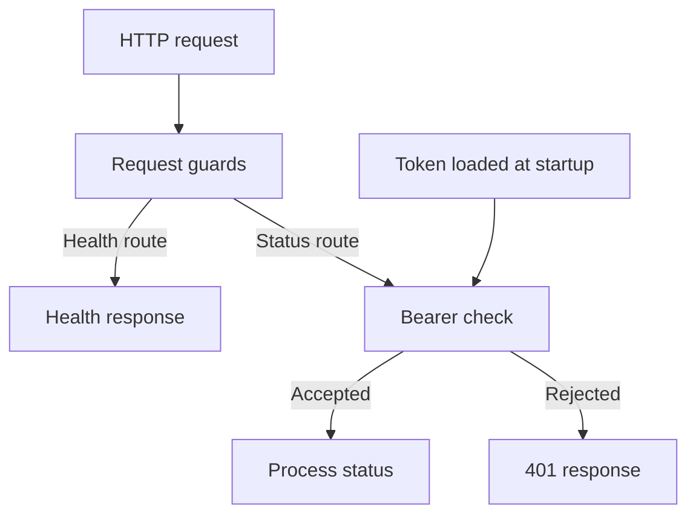

# Architecture and verification boundaries

The repository contains a compiled management service and an unbuilt research snapshot. Their source files, configuration, and evidence have different scopes.

## Compiled management service

| Component | Repository path | Responsibility |
| --- | --- | --- |
| Startup/configuration | [src/main.rs](../src/main.rs) | Load the private token, enforce bind settings, start the runtime, and handle shutdown |
| HTTP surface | [src/lib.rs](../src/lib.rs) | Request guards, health, exact bearer authentication, and process status |
| Dependency graph | [Cargo.toml](../Cargo.toml), [Cargo.lock](../Cargo.lock) | The five direct dependencies and the resolved graph tested by CI |
| Container | [Dockerfile](../Dockerfile), [compose.yaml](../compose.yaml) | Build the management binary and run it with the configured local boundary |
| Setup and tests | [scripts](../scripts), [tests](../tests) | Private local setup, metadata checks, snapshot checks, and management smoke tests |

The diagram describes only this compiled service:

The guards also reject unsupported methods, bodies, oversized application headers/URIs, and excess active handlers. The diagram omits those error branches. These guards are not a global connection/resource-exhaustion guarantee.

## Recovered server organization

This is a map of the supplied source, not a validated execution diagram or integration recipe.

| Area | Source location | Relationship represented in the file |
| --- | --- | --- |
| Management models/handlers | [Roles](../research/snapshots/server/main.rs#L139), [router](../research/snapshots/server/main.rs#L1148) | Account/session models and administrative handler registration |
| Shared state | [AppState](../research/snapshots/server/main.rs#L506) | Common database, listener inventory, concurrent maps, and event sender |
| Listener abstraction | [Trait](../research/snapshots/server/main.rs#L520), [factory](../research/snapshots/server/main.rs#L808) | A common worker interface and variant-to-worker selection |
| Background work | [Log pipeline](../research/snapshots/server/main.rs#L917), [key reaper](../research/snapshots/server/main.rs#L986) | Event retention/export and in-memory expiry handling |
| Record storage | [Helpers](../research/snapshots/server/main.rs#L1881) | Database serialization and prefix-based retrieval for selected records |
| Exchange source | [Inline](../research/snapshots/server/main.rs#L46), [standalone](../research/snapshots/crypto_exchange.rs#L13) | Overlapping server-side exchange implementations referencing shared state |
| Lifecycle | [Startup](../research/snapshots/server/main.rs#L1112), [shutdown](../research/snapshots/server/main.rs#L1214) | Initial state creation, background-task launch, bind selection, and shutdown initiation |

The [feature evidence table](../research/FEATURE_EVIDENCE.md) explains where these components are partial or unsupported by runtime evidence. The matching server workspace is missing, so no authoritative compiled module graph is asserted for the snapshots.

## Isolation and integrity

The research directory contains no Cargo manifest. The root package targets remain `src/lib.rs` and `src/main.rs`. Snapshot files are not imported into them. The root `.dockerignore` excludes `research/`, so reference server/container filenames cannot accidentally become management image inputs.

Git preserves the snapshot bytes without text normalization. The provenance verifier checks each snapshot against recorded size, line count, and SHA-256 values and validates documentation links. These checks establish publication integrity and declared build boundaries; they do not establish the correctness or safety of the recovered implementation.
